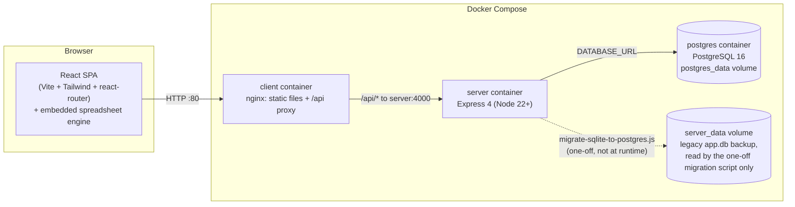
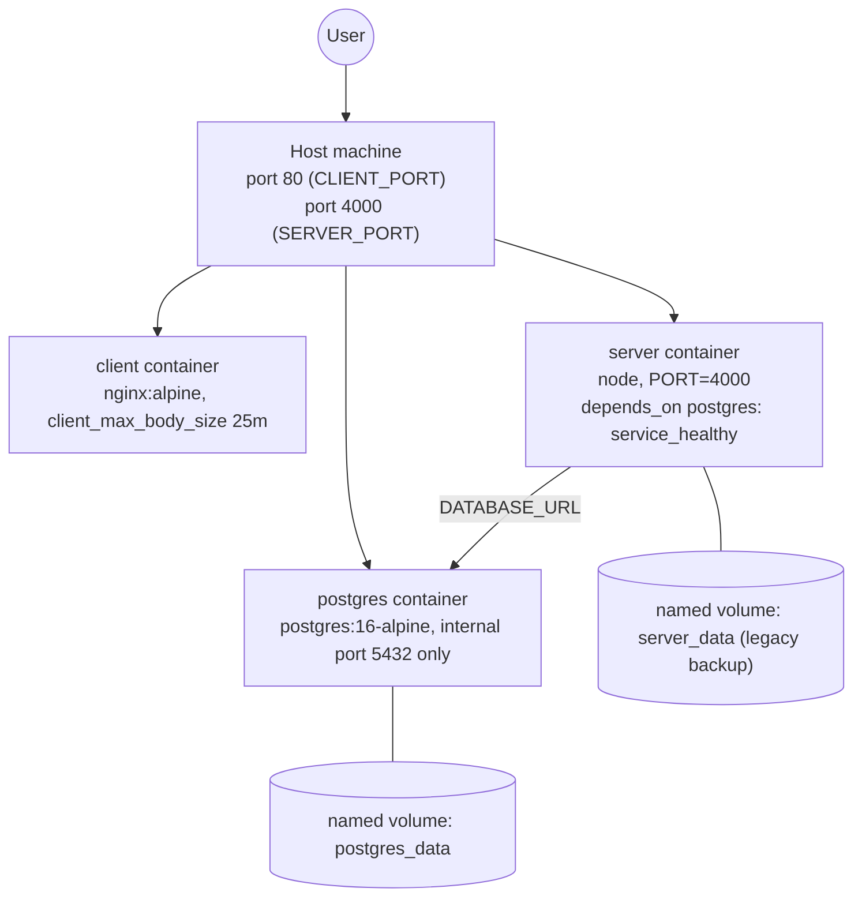
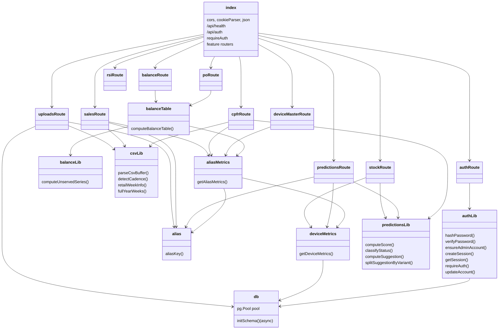
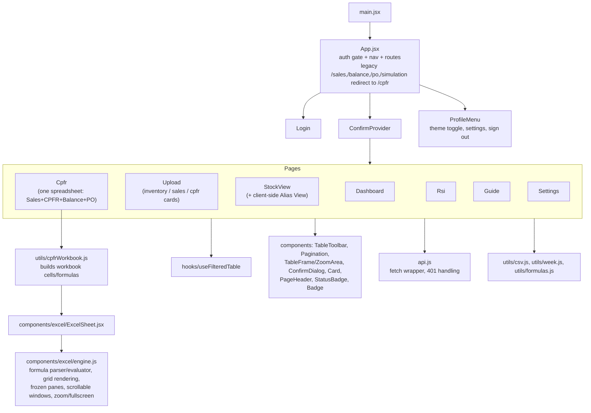
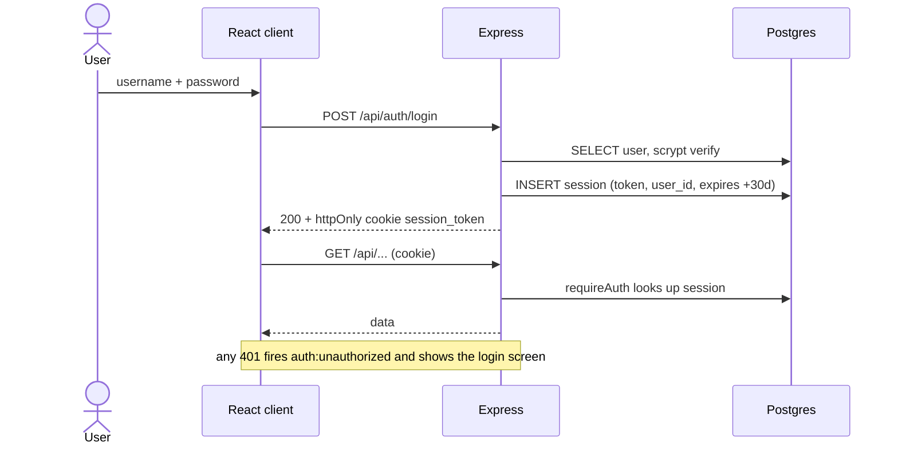
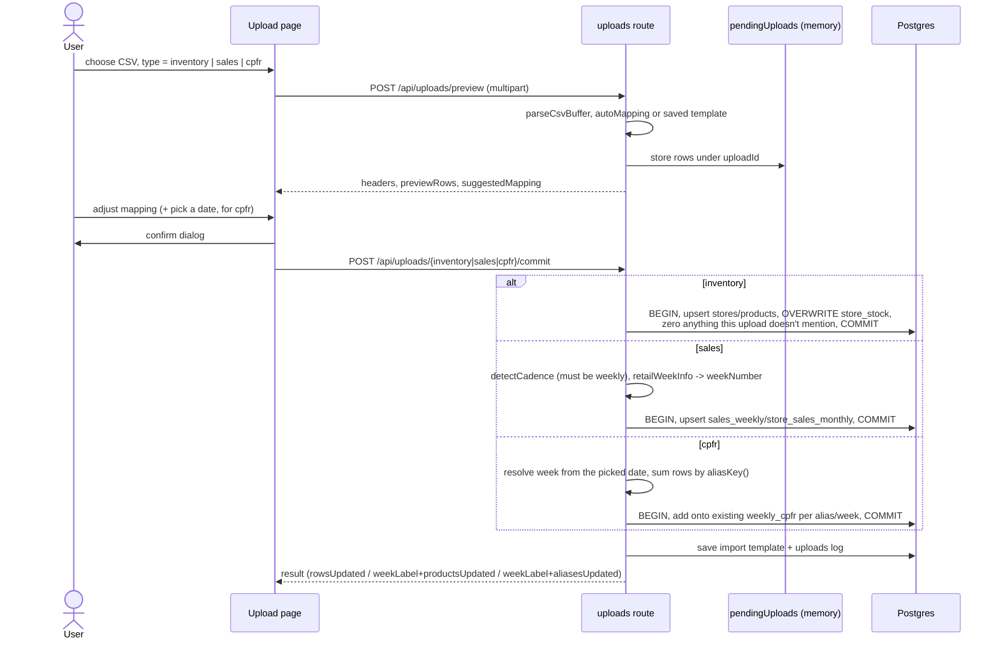
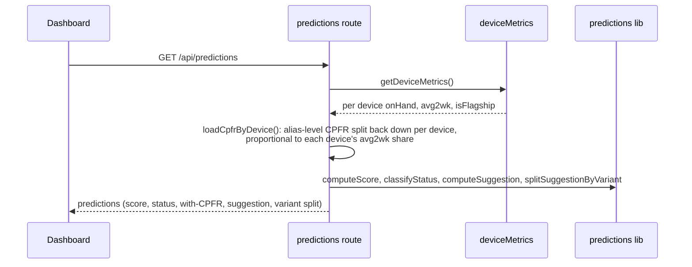
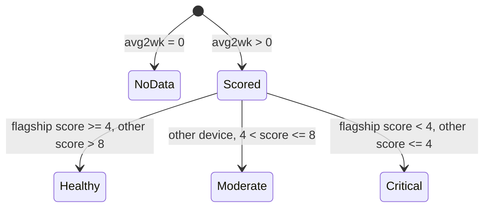

# Architecture (UML)

## 1. Component diagram



## 2. Deployment diagram



## 3. Server module diagram (class-style)



## 4. Client structure



## 5. Sequence: login



## 6. Sequence: upload (preview, then commit)



## 7. Sequence: CPFR sheet load and edit

```mermaid
sequenceDiagram
  participant C as Cpfr page
  participant S as Express routes
  participant AM as aliasMetrics/deviceMetrics
  participant D as Postgres
  C->>S: GET /cpfr, /sales, /balance, /po/all, /device-master (parallel)
  S->>AM: getAliasMetrics() (sums per-device onHand/avg2wk to alias level)
  AM->>D: query products/store_stock/sales_weekly
  S-->>C: per-endpoint alias rows
  C->>C: mergeRows() joins all five responses by alias
  C->>C: buildCpfrWorkbook() lays out one sheet (cells + formulas)
  C->>C: ExcelSheet mounts engine.js, formulas evaluate client-side
  Note over C: user edits a shaded (editable) cell
  C->>S: PUT /cpfr | /balance | /po | /device-master (field-specific)
  S->>D: upsert row
  S-->>C: new value
  C->>C: patch React state; engine recalculates dependent formula cells
```

## 8. Sequence: prediction (Dashboard)



## 9. State diagram: device status


