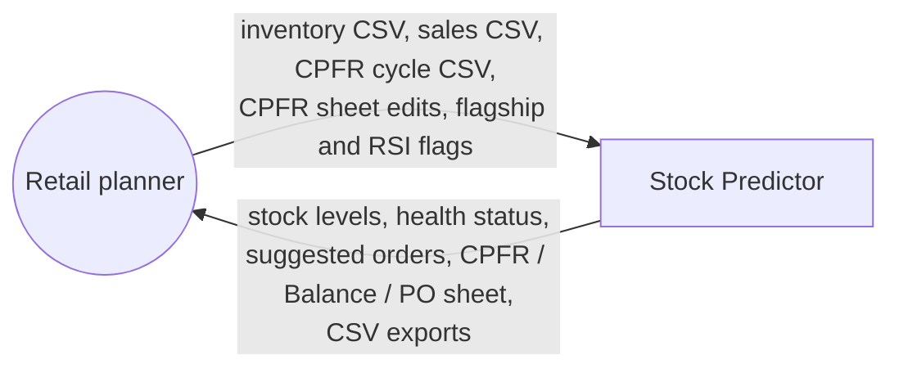
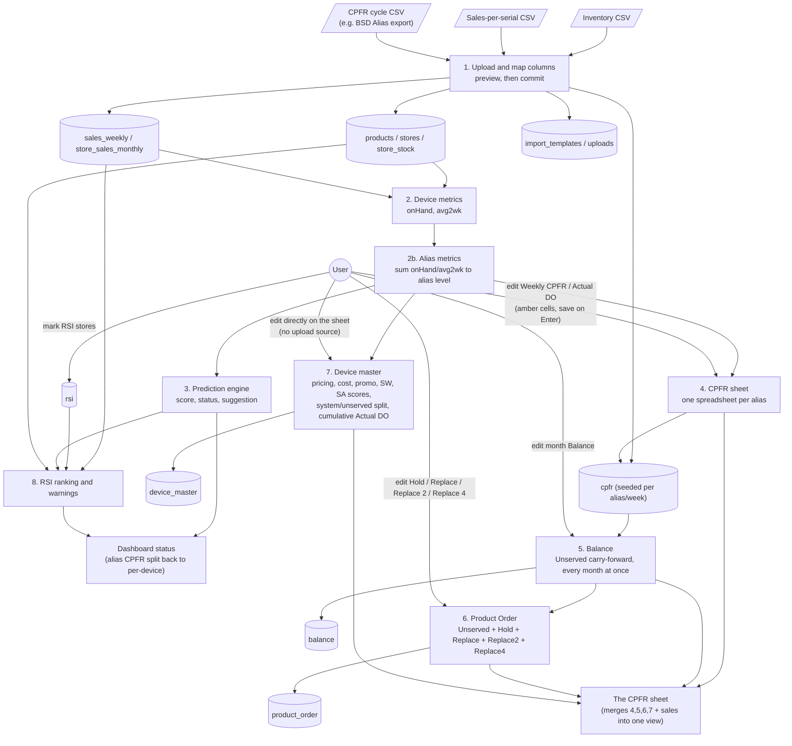
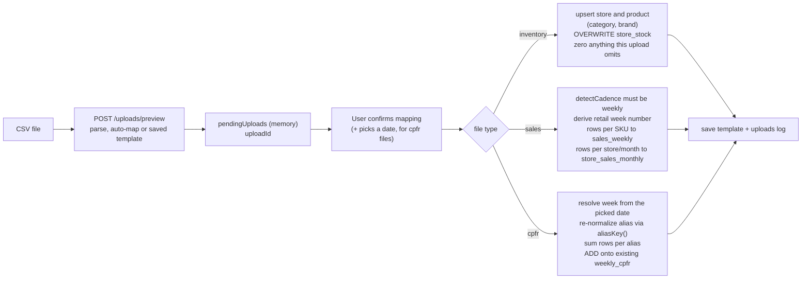
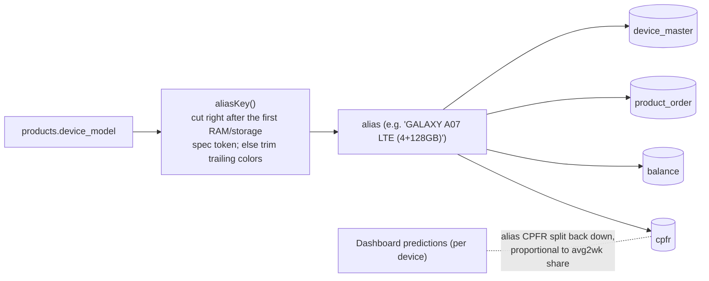
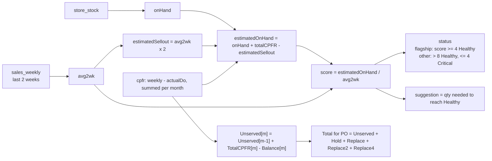

# Data-Flow Diagrams

## Level 0 – context

## Level 1 – main processes

## Upload pipeline (detail)

## Alias grouping

Every device-level metric (on-hand, 2-week average sell-out) is computed per individual `device_model` first (`deviceMetrics.js`, one batched query per metric rather than a per-device loop), then folded up to the **alias** level (`aliasMetrics.js`) before CPFR, Balance, Product Order or device-master data ever sees it — CPFR plans one number per family, not per color/SKU.

## Calculation flow

