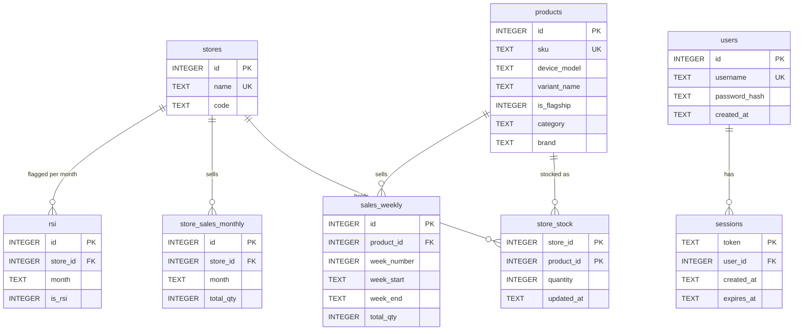
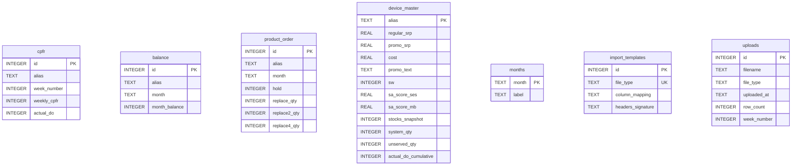

# Entity-Relationship Diagram

Database: SQLite (`node:sqlite`), file `app.db`, created and migrated in [`server/src/db.js`](../server/src/db.js).

Tables keyed by **alias** (every color/SKU sharing a Device Model prefix, combined — see [`server/src/lib/alias.js`](../server/src/lib/alias.js)). They have no foreign key: `alias` is a derived text value, not matched to any single `products` row.

## Table dictionary

| Table | Purpose | Unique key |
|---|---|---|
| `stores` | Retail stores, created automatically on upload | `name` |
| `products` | One row per SKU (variant). `device_model` groups variants into a device; `is_flagship` is set from Stock View | `sku` |
| `store_stock` | On-hand quantity per store per SKU; overwritten by each inventory upload | `(store_id, product_id)` |
| `sales_weekly` | Units sold per SKU per retail week | `(product_id, week_number)` |
| `store_sales_monthly` | Units sold per store per month (drives RSI ranking) | `(store_id, month)` |
| `cpfr` | Planned weekly CPFR and actual delivery orders (DO) per alias — the CPFR sheet's editable Weekly CPFR column | `(alias, week_number)` |
| `balance` | Monthly balance per alias — the CPFR sheet's Balance column | `(alias, month)` |
| `product_order` | Hold / Replace / Replace 2 / Replace 4 quantities per alias per month — the CPFR sheet's Product Order columns | `(alias, month)` |
| `device_master` | Per-alias reference data no upload feed populates — pricing (Regular/Promo SRP), cost, promo copy, sell-through target (SW), the on-hand "system vs. unserved" split, a cumulative Actual DO, and two placeholder SA scores. Plain editable cells on the CPFR sheet | `alias` |
| `rsi` | Which stores are marked RSI for a month | `(store_id, month)` |
| `months` | Every month of the current year is always present (a fixed scaffold, see `balanceTable.js`); this table only holds months explicitly added outside that range (a different year, or a custom label) | `month` |
| `import_templates` | Remembered CSV column mappings (JSON) per file type (`inventory`, `sales`, `cpfr`) | `file_type` |
| `uploads` | Upload history log | none |
| `users` / `sessions` | Login accounts (scrypt hash) and cookie sessions, joined on `user_id` so a mid-session username change doesn't orphan the session | `username` / `token` |

**Alias** (`cpfr`, `balance`, `product_order`, `device_master`): derived from a device model's text by [`aliasKey()`](../server/src/lib/alias.js) — scan tokens left to right for the first RAM/storage spec token (`256GB`, `4+128GB`, `(12GB+256GB)`, or the near-miss typo `64BB`); everything up to and including it must match exactly, everything after (color, edition) is folded together. Falls back to trimming a trailing run of known color words when no spec token exists. The identical rule is duplicated client-side in `client/src/pages/StockView.jsx` for its "Alias View" toggle — kept in sync by hand.

**Week numbers** are `retailYear*100 + retailWeek` (e.g. `202637` = 2026-W37). Retail weeks run Sunday–Saturday; week 1 starts on the Sunday on or before 1 January. `month` values are `YYYY-MM`.
